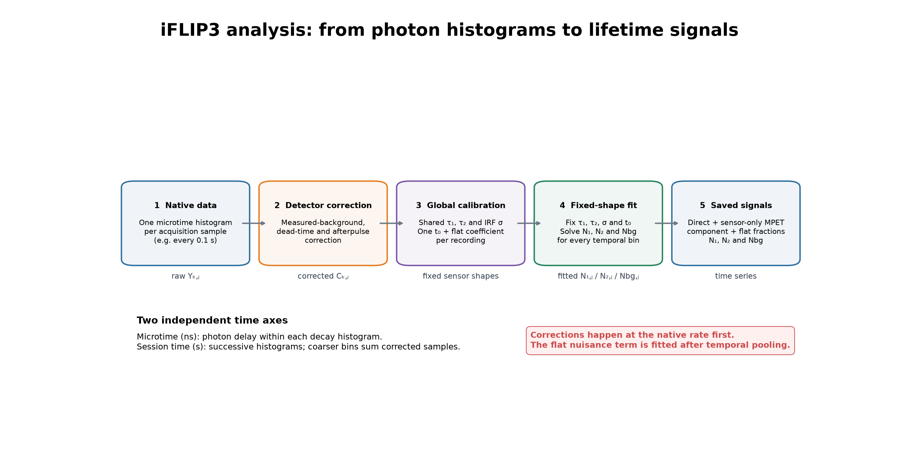
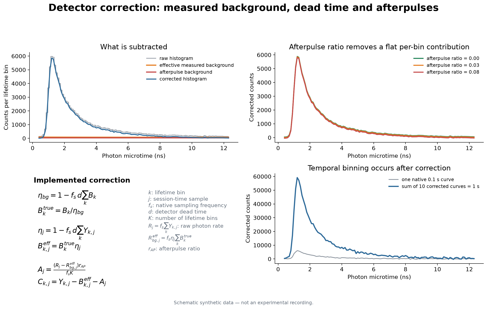
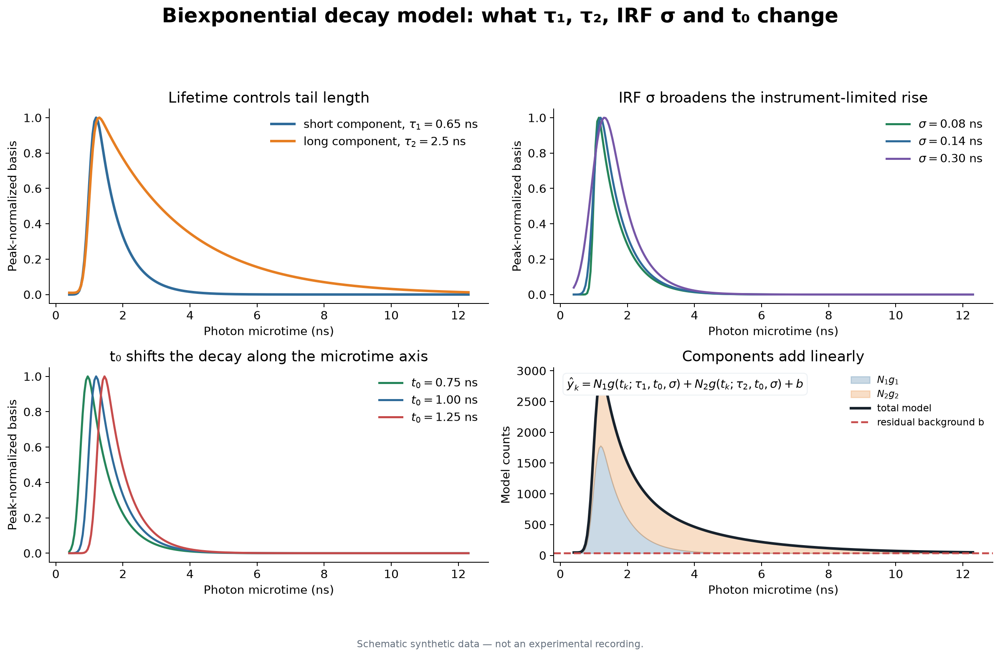
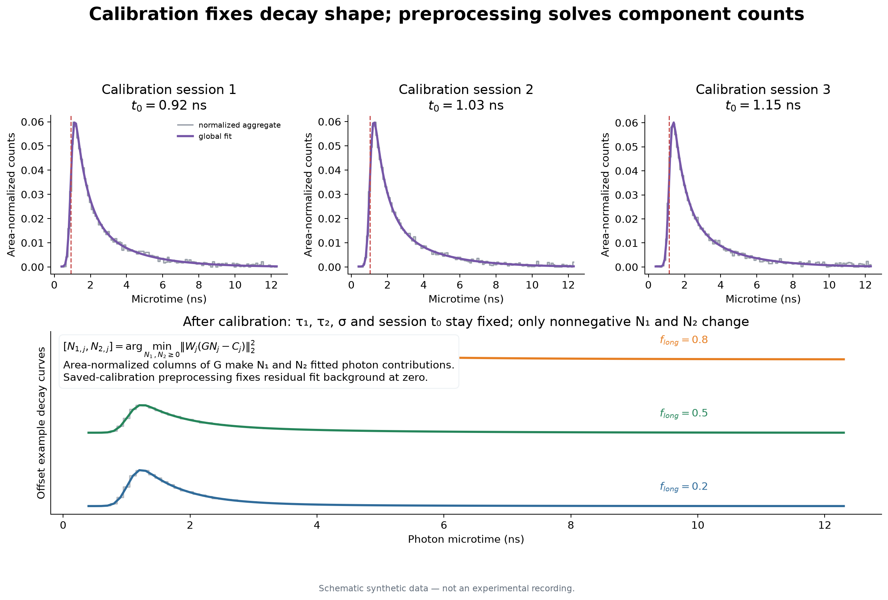
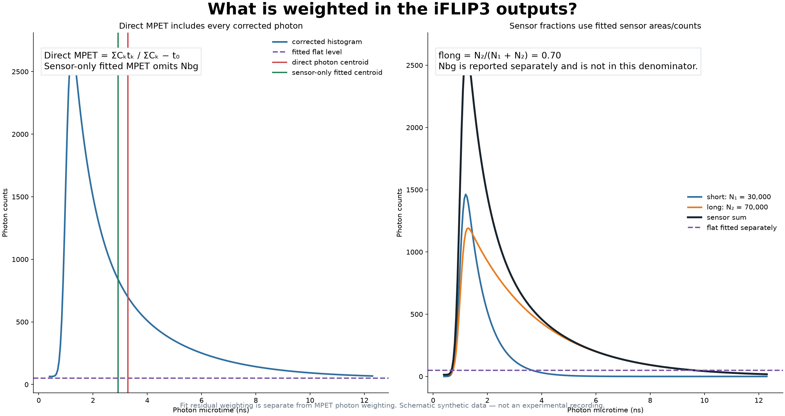

# How iFLIP3 lifetime data are analyzed

This guide explains the maintained iFLIP3 workflow for a reader who has taken
introductory biology, chemistry, or physics but may not yet have worked with
fluorescence lifetime data. The figures use synthetic curves only; they do not
contain animal data or measurements from a real recording.

The short version is:

1. iFLIP3 records a photon-delay histogram at each acquisition time point.
2. Detector background and afterpulsing are corrected at the native sampling
   rate.
3. Compatible sessions are used to calibrate the common decay shapes.
4. Those shapes are fixed, and only their photon contributions are solved at
   each time point.
5. The main outputs are mean photon emission time (MPET), long-component
   fraction, fitted component counts, and raw intensity for quality control.



## 1. What is stored in an iFLIP3 recording?

There are two different time axes. Keeping them separate makes the rest of the
analysis much easier to understand.

### Photon microtime: nanoseconds

After each laser pulse, detected photons are assigned to small delay bins. A
photon in a later bin arrived farther in time from the excitation pulse. The
counts across these delay bins form a fluorescence decay histogram.

We write the raw count in lifetime bin `k` and acquisition sample `j` as

$$Y_{k,j}.$$

Here, `k` indexes photon delay in nanoseconds. It does **not** describe where
the animal was in the behavioral session.

### Session time: seconds

The instrument saves one complete decay histogram per acquisition sample. For
a 10 Hz recording, one histogram represents 0.1 seconds. The index `j`
identifies these successive histograms.

The saved file therefore behaves like a matrix:

```text
                         session time j
                    1       2       3       ...
microtime bin k  1  Y₁,₁    Y₁,₂    Y₁,₃
                 2  Y₂,₁    Y₂,₂    Y₂,₃
                 3  Y₃,₁    Y₃,₂    Y₃,₃
                 ...
```

The native session-time resolution cannot be made finer after acquisition.
For example, a file containing one histogram every 0.1 seconds cannot be
reconstructed at 0.05-second resolution. Coarser bins can be made by summing
adjacent histograms.

## 2. Correcting detector-related counts

Not every detected count is fluorescence from the sensor. The workflow
accounts for three detector effects before calculating lifetime signals:

- measured background counts;
- count loss caused by detector dead time;
- afterpulse counts generated by earlier detection events.



### Measured background

A separate background recording estimates the average count in every lifetime
bin. It must be collected with matching laser power, timing, detector settings,
and optical conditions. Background files should not be pooled merely because
they are available; incompatible backgrounds can bias the decay shape.

Let $B_k$ be the measured background count in lifetime bin $k$, $f_s$ the
session sampling frequency, and $d$ the detector dead time. The implemented
background-efficiency correction is

$$
\eta_{bg}=1-f_s d\sum_k B_k,
$$

followed by

$$
B_k^{true}=\frac{B_k}{\eta_{bg}}.
$$

The same dead-time concept is applied to each measurement sample:

$$
\eta_j=1-f_s d\sum_k Y_{k,j}.
$$

The effective measured background subtracted from sample $j$ is

$$
B_{k,j}^{eff}=B_k^{true}\eta_j.
$$

The efficiency factors decrease when photon rate is high because a detector
cannot register another photon during its dead-time interval.

### Afterpulse correction

An afterpulse is a detector event triggered by a previous detection rather than
by a new photon. The configured afterpulse ratio, $r_{AP}$, estimates the
fraction of the non-background photon rate that returns as afterpulse counts.
The implementation distributes that contribution uniformly across the $K$
lifetime bins:

$$
A_j=\frac{(R_j-R_{bg,j}^{eff})r_{AP}}{f_sK},
$$

where $R_j=f_s\sum_kY_{k,j}$ is the raw photon rate. The final corrected count
matrix is

$$
C_{k,j}=Y_{k,j}-B_{k,j}^{eff}-A_j.
$$

Increasing the afterpulse ratio subtracts more counts from every lifetime bin.
An incorrect ratio can therefore change both total fitted photon counts and the
apparent contribution of the long tail.

### When temporal binning occurs

Detector corrections are calculated on the native histograms first. Adjacent
corrected histograms are then summed when a coarser time bin is requested:

$$
C_{k,q}^{(m)}=\sum_{j=mq}^{mq+m-1}C_{k,j},
$$

where $m$ is the number of native samples in one output bin. Summation preserves
photon counts. It improves shot-noise precision but reduces temporal resolution.

## 3. MPET: a model-independent lifetime measurement

Mean photon emission time is the count-weighted center of the corrected decay
inside the selected lifetime window. For one session-time sample,

$$
\mathrm{MPET}_j=
\frac{\sum_{k\in W}C_{k,j}t_k}{\sum_{k\in W}C_{k,j}}-t_0.
$$

Here:

- $W$ is the artifact-free lifetime window, normally 0.4–12.3 ns;
- $t_k$ is the photon microtime represented by lifetime bin $k$;
- $C_{k,j}$ is the corrected photon count;
- $t_0$ is the instrument timing offset.

The window limits use the acquisition's absolute microtime coordinates; they
are not expressed relative to $t_0$. MPET subtracts $t_0$ only after calculating
the centroid. Consequently, the usual 0.4 ns start can precede the nominal
laser timing near 1 ns and retain the IRF-broadened leading edge.

The standard MPET channel uses `state.t0.Value` from the acquisition header. A
second `mpet_fitted_t0` channel uses the session-specific $t_0$ obtained from
the calibrated decay fit. These traces differ only by the constant
$t_{0,header}-t_{0,fitted}$, so they have identical within-session response
shape but can differ in absolute baseline between animals or acquisition days.

MPET is therefore **photon-count weighted**, which is also reasonably called
intensity weighted. A bin containing twice as many corrected photons contributes
twice as much to the numerator and denominator. MPET does not require a
one- or two-exponential fit.

## 4. The two-component decay model

The target-analysis model represents the corrected decay as the sum of a short
and a long lifetime component:

$$
\widehat C_k=N_1g(t_k;\tau_1,t_0,\sigma,T)
             +N_2g(t_k;\tau_2,t_0,\sigma,T)+b.
$$

The variables are:

| Symbol | Meaning |
|---|---|
| $\tau_1$ | short fluorescence lifetime |
| $\tau_2$ | long fluorescence lifetime |
| $N_1$, $N_2$ | fitted photon contributions from the two components |
| $t_0$ | timing offset between the modeled excitation and recorded microtime axis |
| $\sigma$ | width of the Gaussian instrument response function (IRF) |
| $T$ | laser-pulse interval |
| $b$ | optional constant residual fit background |



### What do $\tau_1$ and $\tau_2$ change?

Each lifetime controls how quickly its component decays. A short lifetime falls
quickly after the peak. A long lifetime produces a broader tail. Changing the
relative photon contributions $N_1$ and $N_2$ changes the mixture without
changing the two underlying decay shapes.

### What is the IRF?

The instrument does not deliver and detect an infinitely narrow pulse. The IRF
describes this timing blur. The implementation convolves each exponential decay
with a Gaussian of width $\sigma$, producing an exponentially modified Gaussian
(an ex-Gaussian). A larger $\sigma$ broadens the leading edge and peak.

The basis also includes fluorescence remaining from preceding excitation pulses.
For $x_m=t-t_0+mT$, the implemented basis is proportional to

$$
g(t;\tau,t_0,\sigma,T)=
\sum_{m=0}^{M}
\exp\left(\frac{\sigma^2}{2\tau^2}-\frac{x_m}{\tau}\right)
\Phi\left(\frac{x_m}{\sigma}-\frac{\sigma}{\tau}\right),
$$

where $\Phi$ is the standard normal cumulative distribution function. This
formula combines exponential fluorescence decay, Gaussian instrument timing,
and the periodic laser pulses.

### What does $t_0$ change?

$t_0$ shifts the modeled decay along the microtime axis. Small differences in
instrument timing between recordings can otherwise look like lifetime changes.
The calibration therefore permits a separate $t_0$ for each recording while
sharing the biological lifetime shapes.

### Two meanings of background

It is important not to confuse:

1. **Measured detector background**, which is estimated from a separate file
   and subtracted before fitting.
2. **Residual fit background** $b$, which is an optional constant term used by
   a single aggregate fit to absorb a remaining baseline mismatch.

The saved multi-session calibration excludes residual fit background, and
saved-calibration preprocessing fixes it at zero. This prevents a flat
background term from competing with the long-lifetime component at every time
point.

## 5. Multi-session calibration

Trying to estimate $\tau_1$, $\tau_2$, $t_0$, $\sigma$, $N_1$, and $N_2$ from
every 0.1-second histogram would be unstable. Individual histograms contain far
fewer photons than an entire session, and several parameters can compensate for
one another.

Calibration instead uses high-count aggregate decays from multiple compatible
sessions:

1. Correct every native histogram.
2. Sum the corrected histograms within each recording.
3. Divide each aggregate decay by its positive area. This gives each recording
   comparable influence rather than allowing the brightest recording to
   dominate.
4. Fit common $\tau_1$, $\tau_2$, and IRF $\sigma$.
5. Fit a separate $t_0$ and component amplitudes for each recording.
6. Exclude residual fit background from this calibration.



Only recordings with compatible lifetime-bin axes, pulse intervals, detector
settings, and optical conditions should share a calibration.

## 6. Fixed-shape target analysis during preprocessing

After calibration, the nonlinear shape parameters are fixed. For each temporal
bin $j$, the program solves only the two nonnegative component contributions:

$$
[N_{1,j},N_{2,j}]
=\underset{N_1,N_2\ge0}{\operatorname{argmin}}
\left\|W_j(GN_j-C_j)\right\|_2^2.
$$

$G$ contains the fixed short and long decay shapes. Its columns are normalized
to unit area, so $N_1$ and $N_2$ represent fitted photon contributions rather
than peak heights. Nonnegative least squares prevents the fit from explaining
noise using a negative biological component.

For a session included in the calibration, its saved session-specific $t_0$ is
used. For a compatible new session, $t_0$ can be estimated from that session's
aggregate decay while $\tau_1$, $\tau_2$, and $\sigma$ remain fixed.

### Residual weighting in the fit

When all fitted bins are nonnegative, the code uses approximate Poisson
weighting:

$$
w_{k,j}=\frac{1}{\sqrt{\max(C_{k,j},1)}}.
$$

This prevents the high-count peak from completely dominating the least-squares
objective. If background correction creates negative bins, Poisson weighting is
not mathematically defined and the code uses unweighted residuals instead.

This statistical residual weighting is different from the photon-count
weighting used to calculate MPET.

## 7. What the reported component fraction means

Because the component bases have unit area, the long-component fraction is

$$
f_{long,j}=\frac{N_{2,j}}{N_{1,j}+N_{2,j}}.
$$

It is an **area/count-weighted fraction of fitted photons**. It is not the
fraction obtained by comparing the peak heights of the short and long curves.
The long component spreads its photons across more lifetime bins, so its peak
can be lower even when it contains most of the fitted photons.

The software also reports the **long pre-exponential amplitude fraction**. Let
$S_i$ be the area of the unnormalized periodic, IRF-convolved basis for
component $i$ over the fitted lifetime window. The fitted pre-exponential
coefficient is

$$
A_{i,j}=\frac{N_{i,j}}{S_i},
$$

and the long amplitude fraction is

$$
f^{(A)}_{long,j}=\frac{A_{2,j}}{A_{1,j}+A_{2,j}}.
$$

This is the model's time-zero amplitude fraction, not the fraction of observed
photons. Using the exact basis areas matters because the IRF, periodic excitation,
$t_0$, and fitted time window all affect the conversion from area to amplitude.

Two fitted lifetime summaries are available:

$$
\tau_{amplitude,j}=\frac{A_{1,j}\tau_1+A_{2,j}\tau_2}{A_{1,j}+A_{2,j}},
$$

$$
\tau_{intensity,j}=\frac{N_{1,j}\tau_1+N_{2,j}\tau_2}{N_{1,j}+N_{2,j}}.
$$

Here “intensity-weighted” means weighted by each fitted component's integrated
photon contribution; it does not mean weighting by the raw brightness trace.
These are derived from the same fixed-shape fit and do not introduce a second
fit.



The main output channels answer related but different questions:

| Output | Calculation | Interpretation |
|---|---|---|
| MPET | corrected photon-count centroid minus $t_0$ | model-independent shift in photon timing |
| Long fraction | $N_2/(N_1+N_2)$ | fraction of fitted photons assigned to the long state |
| Long amplitude fraction | $A_2/(A_1+A_2)$ | fraction of the fitted pre-exponential amplitude assigned to the long state |
| Amplitude-weighted fitted lifetime | $\sum A_i\tau_i/\sum A_i$ | lifetime summary emphasizing pre-exponential amplitudes |
| Intensity-weighted fitted lifetime | $\sum N_i\tau_i/\sum N_i$ | lifetime summary emphasizing integrated fitted photons |
| $N_1$, $N_2$ | nonnegative coefficients of area-normalized bases | fitted photon contribution of each state |
| Raw intensity | sum of recorded counts | brightness and acquisition QC |

Agreement between MPET and long fraction strengthens confidence that a result
reflects a decay-shape change. A change seen only in intensity may instead
reflect brightness, fiber coupling, motion, or another acquisition artifact.

## 8. Practical interpretation checklist

Before interpreting a biological effect, ask:

- Was a laser-power- and detector-matched background used?
- Was the afterpulse ratio recorded with the output?
- Are all sessions in a shared calibration acquisition-compatible?
- Do aggregate fits and residuals look reasonable for every calibration
  session?
- Are fitted component counts high enough for the chosen temporal bin?
- Do MPET and long-component fraction change in the same direction?
- Is the effect still present without a large simultaneous intensity artifact?
- Is the chosen temporal bin short enough for the biological question?

Temporal pooling improves shot-noise precision approximately with the square
root of the number of pooled native samples, but it also blurs fast changes.
The smallest useful bin should therefore be chosen from both photon precision
and the timescale of the biology, not from photon count alone.

## 9. Where this appears in the software

The Streamlit GUI supports this workflow under the iFLIP3 lifetime analysis:

- inspect compatible sessions and build a multi-session calibration;
- view photon-count sensitivity across temporal bin sizes;
- select native or coarser temporal pooling for preprocessing;
- save the calibration and record preprocessing provenance;
- inspect MPET, component fraction, intensity, fit residuals, and synchronization
  quality;
- optionally overlay count fraction with pre-exponential amplitude fraction and
  plot amplitude- or intensity-weighted fitted lifetime traces;
- interactively move the MPET microtime-window endpoints, view their positions
  relative to the corrected decay and header $t_0$, and compare the resulting
  standardized MPET response with the fitted fraction and lifetime summaries;
- compare header- and fitted-$t_0$ MPET directly and inspect the timing offset
  that could contribute to absolute MPET variability across sessions.

The maintained implementation is in:

- `iflip3/preprocessing.py`: detector correction, MPET, and temporal pooling;
- `iflip3/models.py`: periodic Gaussian-convolved exponential basis;
- `iflip3/fitting.py`: bounded and global calibration fits;
- `iflip3/target.py`: fixed-basis nonnegative target analysis;
- `lutaslab_photometry/lifetime_workflows.py`: calibration and GUI-facing
  preprocessing workflow.

See the package [README](../README.md) for installation, notebooks, event
alignment, and the public API.
